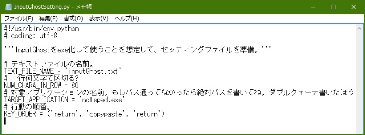

InputGhost
===

It automatically pastes text lines to other application. Only available for Windows.



## 仕組み

- `inputGhost.txt` (cp932) を読み、各行を `NUM_CHARA_IN_ROW` 文字ずつに分割します。
- 分割した文字列ごとに、focus されている window へ clipboard と `keybd_event` を使って `KEY_ORDER` (`'0'`・`'return'`・`'copypaste'`) を実行します。
- 設定は `InputGhostSetting.py` に書きます。不正な `KEY_ORDER` は、入力を始める前に検出します。
- `copypaste` では、clipboard が貼り付けたい文字列になるまで 0.1 秒ごとに確認します。`CLIPBOARD_TIMEOUT` 秒 (既定 5 秒) 待っても変わらない場合は、Ctrl+V を送らずに `GreenException` で停止します。それまでに送った入力は入力先に残ります。押しっぱなしの key はありません。

## 実行環境

- Windows + Python 3 (CI は `windows-latest` 上の 3.13 を使います)
- Dependency: `pyperclip` (`requirements.txt`)
- Docker: 非対応です。Windows desktop の focus・clipboard・key event を操作するため、container では動作を再現できません。

## パッと安全に試したい

```bat
py -m venv .venv
.venv\Scripts\python -m pip install -r requirements.txt
.venv\Scripts\python InputGhost.py --dry-run
```

`--dry-run` は実行予定だけを表示します。key を送らず、clipboard を変更せず、入力先の application も起動しません。

通常実行 (`--dry-run` なし) は、focus されている window へ入力して clipboard を上書きします。空の Notepad とテスト用の文章だけで試してください。

## 開発

```bat
.venv\Scripts\python -m pip install -r requirements-dev.txt
.venv\Scripts\ruff check .
.venv\Scripts\python -m pytest
```

- Linter: ruff (`pyproject.toml` に rule を書いています)
- Tests: pytest (`tests/`)。Windows 入力を fake に置き換えるため、実際の key は送りません。
- CI (`.github/workflows/ci.yml`) は `windows-latest` 上で lint・test・`--dry-run` smoke check を実行します。deploy は行いません。
